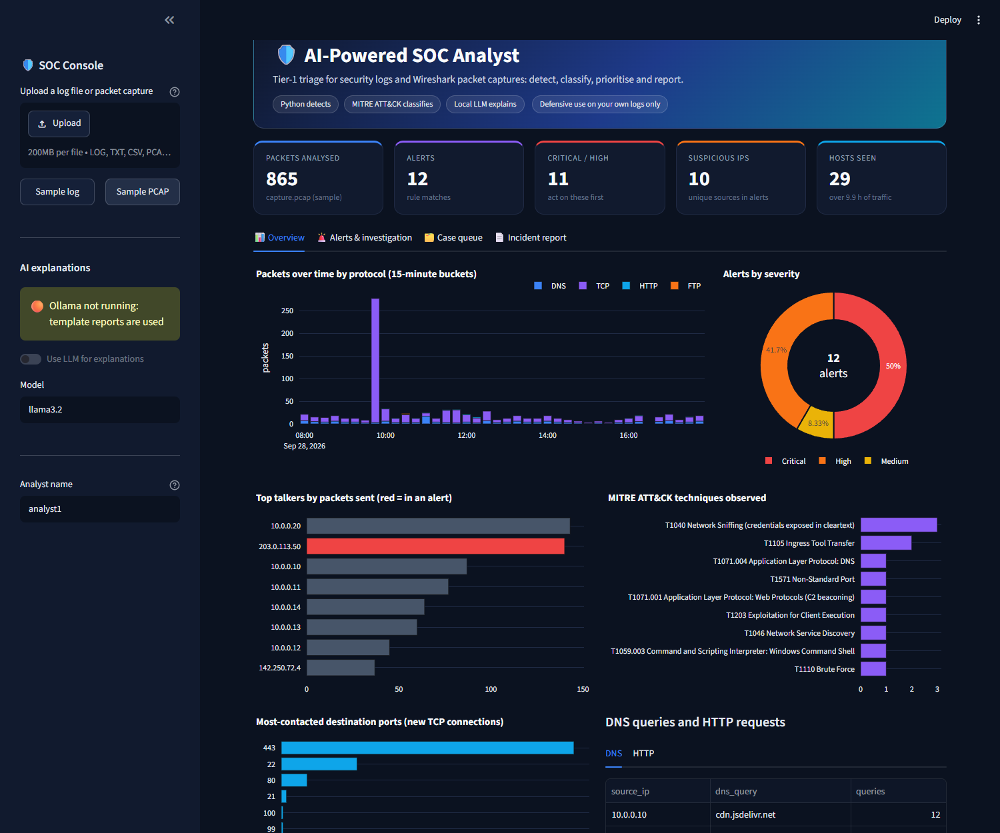
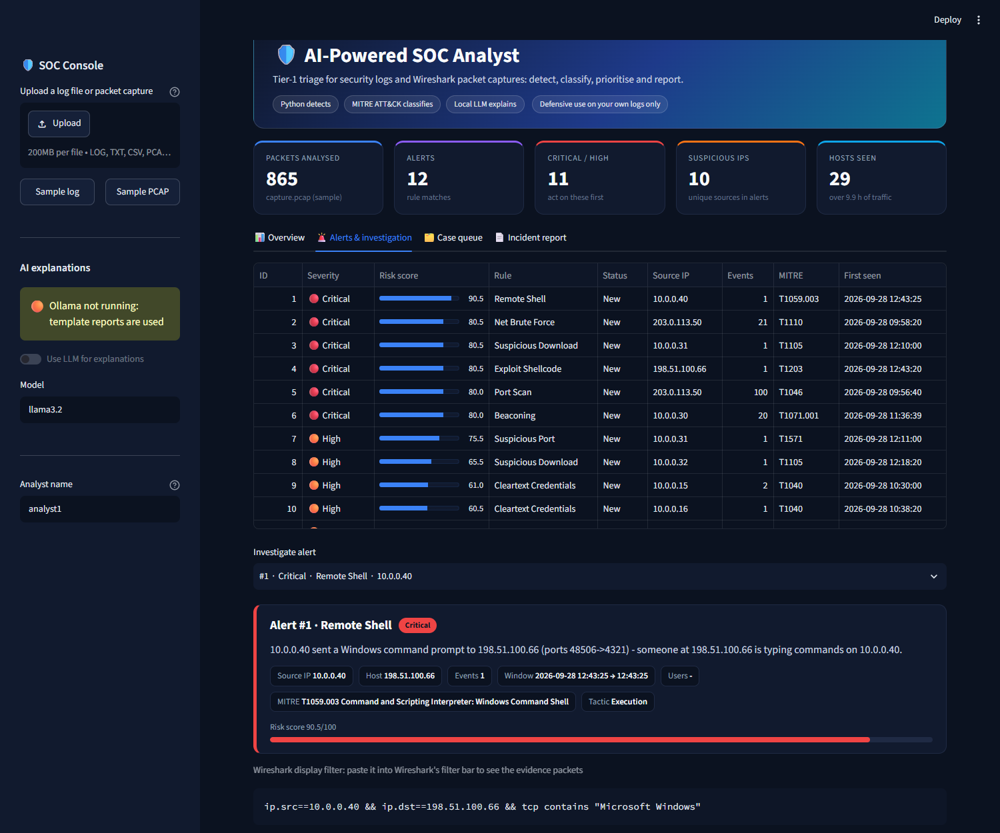
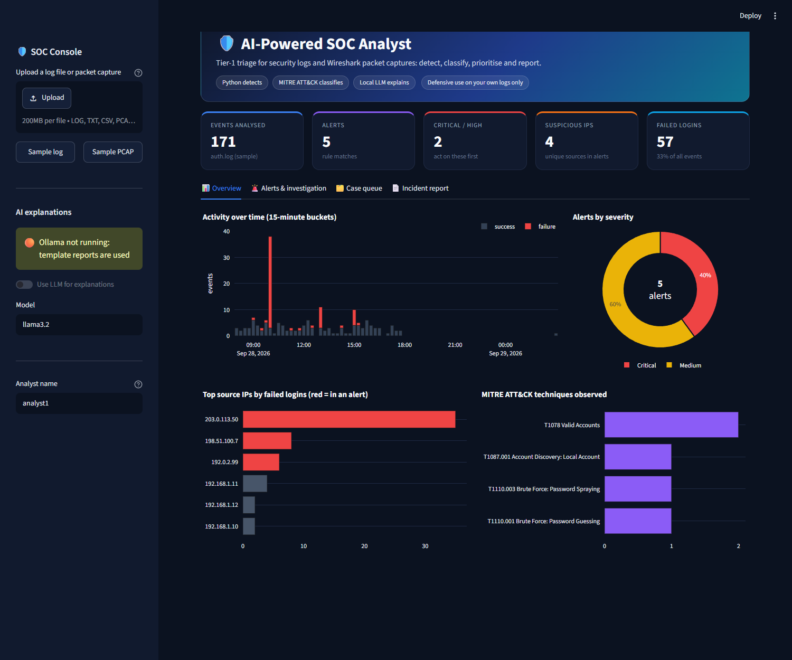
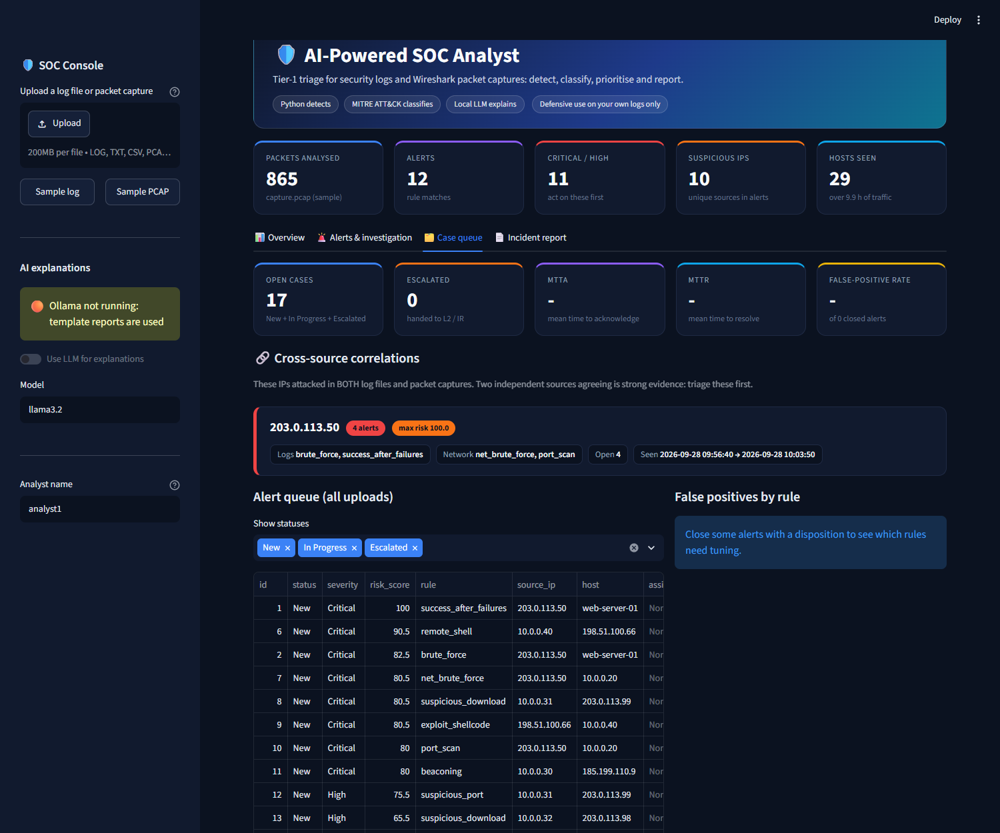
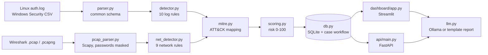
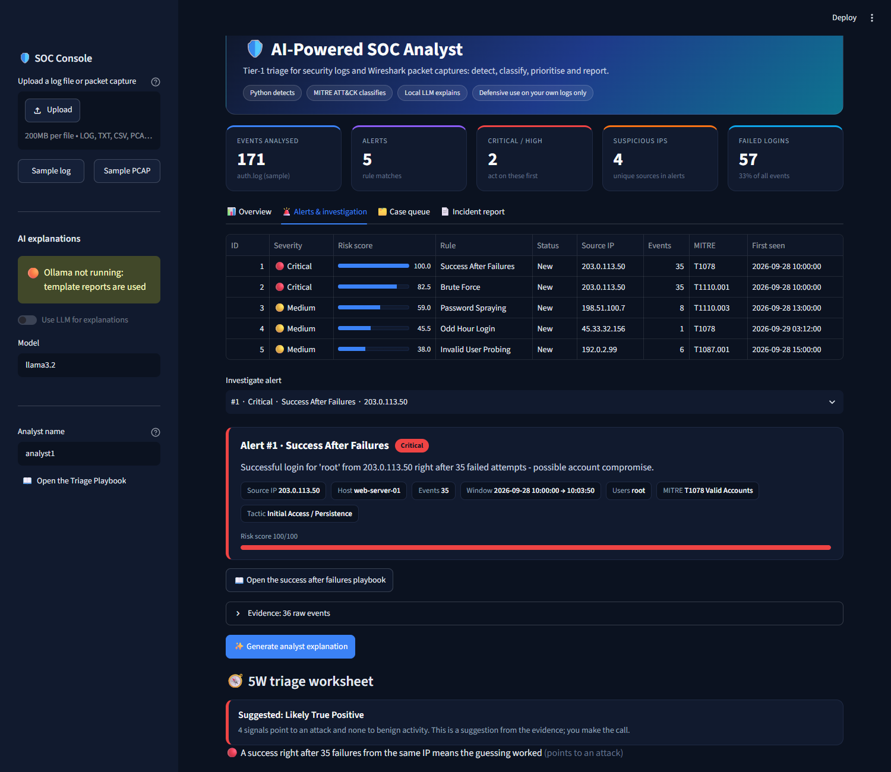
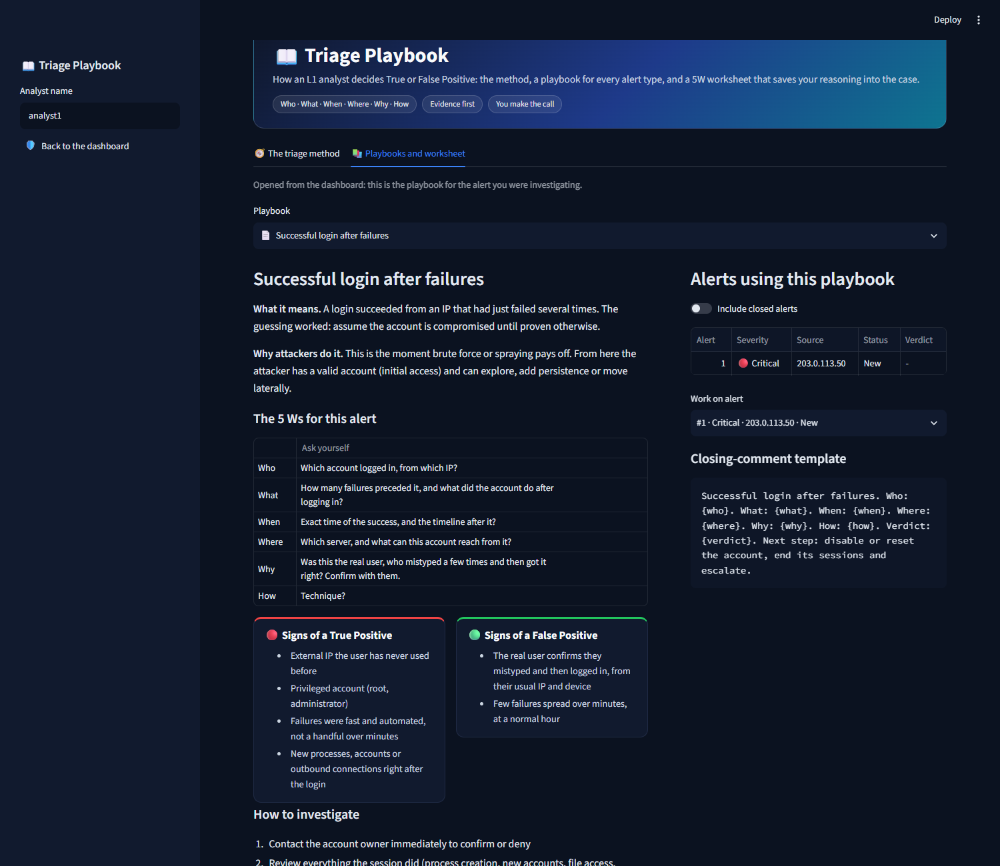

# 🛡️ AI-Powered SOC Analyst

[](https://github.com/muskabhishek/soc-ai-analyst/actions/workflows/tests.yml)


A **defensive**, fully local tool that does the work of a Tier-1 SOC analyst. It reads **security logs** (Linux SSH,
Windows Security events) and **Wireshark packet captures**, detects attacks with 19 rules, maps each one to
**MITRE ATT&CK**, scores the risk, tracks every alert as a case, and uses a local LLM (Ollama) to write the analyst
report. Every rule is also provided as a **Splunk SPL** and **Microsoft Sentinel KQL** query.

> **Design rule:** Python decides *what is a threat*. The LLM only *explains and prioritises*. It never decides
> threat status, and its output is checked for IP addresses it invented.

## Results

| Test | Result |
|---|---|
| Planted attacks in generated logs and captures (24 attacks across Linux, Windows and network data) | **all detected, no false positives** (25 automated tests) |
| Real SSH log from an internet-facing server (86,839 lines) | **236 alerts, 0 on internal IPs**, 2 root brute-force bursts, ~10 s ([write-up](docs/real-data-results.md)) |
| 13 real public packet captures (~107,600 packets) | **4 of 7 attacks detected, 0 of 6 normal captures flagged** ([write-up](docs/pcap-real-results.md)) |

Testing on real data changed the code: it exposed a log format the rules did not expect, scan noise, a false
positive on a 90 MB Linux ISO download, and three attacks that needed new detections. Each write-up lists what was
missed and what would catch it.

## Screenshots

| Packet-capture analysis | Alert with its Wireshark filter |
|---|---|
|  |  |
| **Log analysis** | **Case queue with cross-source correlation** |
|  |  |

## How it works



Uploads are recognised by their content (file signature), not their name. `pipeline.py` runs the steps in order,
so the dashboard and the API always give the same answer.

## Detection coverage

**Logs (10 rules)**: thresholds in `CONFIG` in [src/detector.py](src/detector.py)

| Rule | Logic | MITRE |
|---|---|---|
| Brute force | >=10 failed logins from one IP in 5 min (sliding window) | T1110.001 |
| Password spraying | one IP, >=5 distinct usernames in 10 min | T1110.003 |
| Success after failures | a login succeeds after >=5 failures from the same IP | T1078 |
| Invalid user probing | >=5 non-existent usernames from one IP | T1087.001 |
| Odd-hour login | successful login 00:00-05:00 | T1078 |
| New account created | Windows 4720 | T1136.001 |
| Added to privileged group | Windows 4732 into Administrators / Domain Admins / Enterprise Admins / Schema Admins | T1098 |
| Account lockout | Windows 4740 | T1110 |
| Suspicious PowerShell | Windows 4688 command line with `-enc`, `-w hidden`, `IEX`, `DownloadString`, `FromBase64String` | T1059.001 |
| Audit log cleared | Windows 1102 | T1070.001 |

**Network traffic (9 rules)**: every alert carries a **Wireshark display filter** to jump to the evidence packets

| Rule | Logic | MITRE |
|---|---|---|
| Port scan | one source sends SYNs to >=20 ports on one host in 60 s | T1046 |
| Network brute force | >=15 new connections to SSH/RDP/FTP/Telnet/VNC from one source in 60 s | T1110 |
| Cleartext credentials | FTP `USER`/`PASS`, HTTP Basic auth or a login form posted over HTTP (passwords masked at parse time) | T1040 |
| Suspicious DNS | >=5 queries with a 30+ character or high-entropy (random-looking) label | T1071.004 |
| Beaconing | >=6 connections to one server at near-constant intervals (jitter <= 10%) | T1071.001 |
| Suspicious download | `.exe`/`.dll`/`.ps1`/`.hta`... over HTTP, or a response body that **starts** with a Windows executable header | T1105 |
| Suspicious port | an **answered** connection to 4444, 1337, 31337, 6667, 5555 | T1571 |
| Remote shell | a `cmd.exe` banner or root `id` output inside a TCP stream | T1059.003 |
| Exploit shellcode | Metasploit stager byte patterns (`fc e8 89 00 00 00`...) | T1203 |

**Cross-source correlation:** an IP that attacks in both a log file and a packet capture is listed first in the Case
queue. In the samples, 203.0.113.50 port-scans and brute-forces the server in the capture, and its successful root
login shows up in `auth.log`.

## SIEM-ready detections
All 10 log rules are also written as **Splunk SPL** and **Microsoft Sentinel KQL** queries in
[detections/](detections/), with the same thresholds and MITRE IDs. They match the documented field names of each
platform but have not yet been run against a live SIEM ([details](detections/README.md)).

## Triage playbooks: deciding True vs False Positive
Detection says *something happened*; triage decides *whether it matters*. A separate **Triage Playbook** page teaches
and records that decision, following the 5W method used in SOC L1 training (Who, What, When, Where, Why, and How):

- **The method**: pick by severity, take ownership, answer the 5 Ws from evidence, weigh the signs, decide, write the
  comment ([playbooks/_method.md](playbooks/_method.md)).
- **One playbook per rule** ([playbooks/](playbooks/), plain YAML): what the alert means, why attackers do it, the 5W
  questions for that alert type, signs of a True vs a False Positive, how to investigate, a verdict guide, next steps
  and a closing-comment template.
- **A 5W worksheet on every alert**, in the dashboard and on the playbook page. The tool fills in what it can read
  from the alert (*Who: root from 203.0.113.50 (external)*), lists evidence signals that lean True or False Positive,
  and **suggests** a verdict. **Why** is left to the analyst. Saving records the answers, the verdict and a drafted
  comment in the case and its audit trail; the analyst always makes the call.
- **Connected both ways:** *Open playbook* on an alert opens its playbook with that alert selected; the playbook page
  lists every open alert of that type and can jump back to it in the dashboard.

| 5W worksheet in the dashboard | Triage Playbook page |
|---|---|
|  |  |

## Case workflow
Every alert is a case: **New -> In Progress -> Escalated -> Closed**. Closing requires a disposition (*True Positive*,
*Benign True Positive* or *False Positive*), and every assignment, status change and note goes into an audit trail.
The Case queue reports the KPIs a SOC manager tracks: **MTTA**, **MTTR**, and the **false-positive rate per rule**,
which shows which detections need tuning.

## Quick start
```bash
pip install -r requirements.txt
python -m src.generator                 # sample auth.log, Windows CSV and capture.pcap with hidden attacks
python -m pytest -q tests               # 25 tests: every planted attack found, no false positives
streamlit run dashboard/app.py          # UI  -> http://localhost:8501  (or /?sample=pcap for an instant demo)
uvicorn api.main:app --reload           # API -> http://127.0.0.1:8000/docs

# optional
ollama pull llama3.2                    # AI-written explanations (otherwise a fixed template is used)
python scripts/real_data_benchmark.py   # real SSH log benchmark
python scripts/pcap_benchmark.py        # real packet-capture benchmark
```
Environment variables: `OLLAMA_URL` (default `http://localhost:11434`), `OLLAMA_MODEL` (default `llama3.2`), `SOC_DB`.

## API
| Endpoint | Purpose |
|---|---|
| `POST /upload-logs` | upload a log file or packet capture; it is analysed and stored |
| `GET /alerts`, `GET /alerts/{id}` | list alerts (filter by `upload_id`, `status`) / one alert with evidence and report |
| `POST /alerts/{id}/explain` | generate and store the LLM or template explanation |
| `PATCH /alerts/{id}/status`, `PATCH /alerts/{id}/assign` | move a case through the workflow / assign it |
| `POST /alerts/{id}/notes`, `GET /alerts/{id}/activity` | analyst notes and the audit trail |
| `GET /correlations` | IPs that attacked in both log files and packet captures |
| `GET /metrics` | queue by status, MTTA, MTTR, false-positive rate overall and per rule |
| `GET /playbooks`, `GET /playbooks/{rule}?alert_id=` | triage playbooks; with an alert: pre-filled 5 Ws, evidence signals, suggested verdict, drafted comment |
| `GET`/`PUT /alerts/{id}/worksheet` | the analyst's saved 5W worksheet, verdict and closing comment |
| `GET /report/{upload_id}` | full Markdown incident report |
| `GET /stats`, `GET /health` | counters / Ollama status |

## Project structure
```
src/
  parser.py          logs -> common schema (Linux SSH incl. key-only servers, Windows Security CSV)
  pcap_parser.py     .pcap/.pcapng -> per-packet rows (ports, TCP flags, DNS, HTTP, credentials, signatures)
  detector.py        10 log rules          net_detector.py   9 network rules
  mitre.py           rule -> ATT&CK         scoring.py        risk score and severity
  llm.py             Ollama report, template fallback, invented-IP check
  db.py              SQLite, case workflow, worksheets, metrics, correlations
  playbooks.py       5W auto-fill, evidence signals, suggested verdict, drafted comment
  pipeline.py        runs the steps          generator.py      sample data with planted attacks
api/main.py          FastAPI backend         dashboard/        app.py + pages/1_Triage_Playbook.py
detections/          Splunk SPL and Sentinel KQL versions of the log rules
scripts/             real-data benchmarks    docs/             results and screenshots
playbooks/           one triage playbook per rule (YAML) + the 5W method
tests/               25 automated tests
```

## Supported inputs
- **Packet captures:** `.pcap` / `.pcapng` from Wireshark or tcpdump (up to 500,000 packets per file)
- **Linux SSH `auth.log`:** failed / accepted passwords, invalid users, and key-only servers' "Too many
  authentication failures" lines (the missing source IP is recovered from the same sshd process when possible)
- **Windows Security CSV:** `timestamp,host,event_id,user,ip[,target_user,group,command_line]` with Event IDs
  4624, 4625, 4720, 4732, 4740, 4688 and 1102

## Limitations and next steps
- Pattern rules miss attacks that look like normal HTTPS or use custom protocols; **threat-intelligence lookups**
  (IP/domain reputation) are the next feature.
- Encrypted traffic only exposes addresses, ports, timing and sizes, so payload signatures do not apply to it.
- Scapy parses about 3,000 packets/s; very large captures would need `tshark` or `dpkt`.
- The SPL/KQL queries still need validating in a live Splunk or Sentinel instance.

## Ethics and scope
Defensive analysis only. Run it on logs, captures and systems you own or are authorised to monitor. The sample
attack data is generated: packets are written to a file and never sent.
